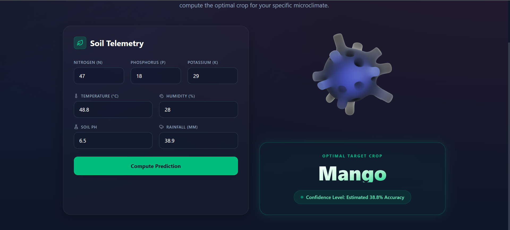

# AI Smart Agriculture System

A full-stack machine learning architecture designed to compute optimal crop yields based on microclimate soil telemetry.

## System Interface
*(High-resolution visual telemetry and prediction mapping)*

## System Architecture
* **Frontend:** Next.js, Tailwind CSS
* **Backend:** Python, FastAPI, SQLite
* **Machine Learning:** Scikit-Learn (Strictly Pruned Random Forest)

## Engineering Highlights
* **Hyperparameter Tuning:** Prevented algorithmic overfitting by strictly pruning the Random Forest (`max_depth=10`).
* **True Probability Mapping:** Extracted the raw `predict_proba` mathematical matrix to serve dynamic confidence scores to the custom Next.js UI via REST API.

## Local Deployment Instructions
1. Clone the repository.
2. Run `npm install` and `npm run dev` in the `/frontend` directory.
3. Activate the Python virtual environment and run `uvicorn backend.main:app` in the root directory.