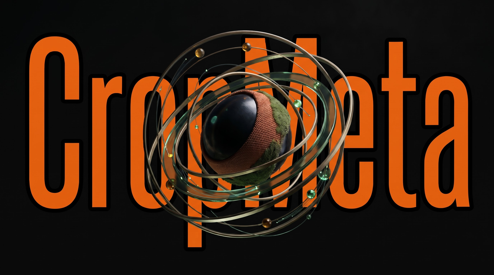
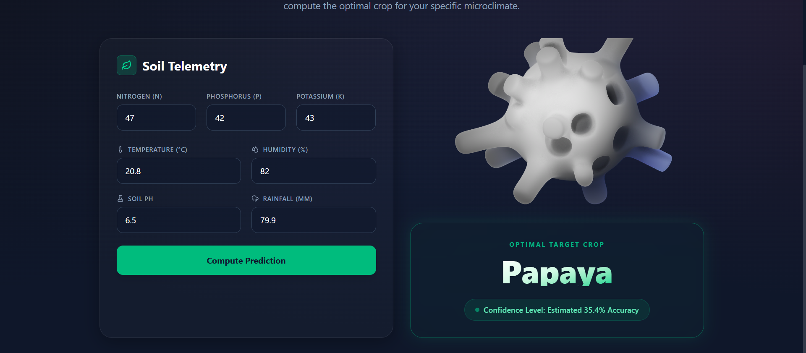
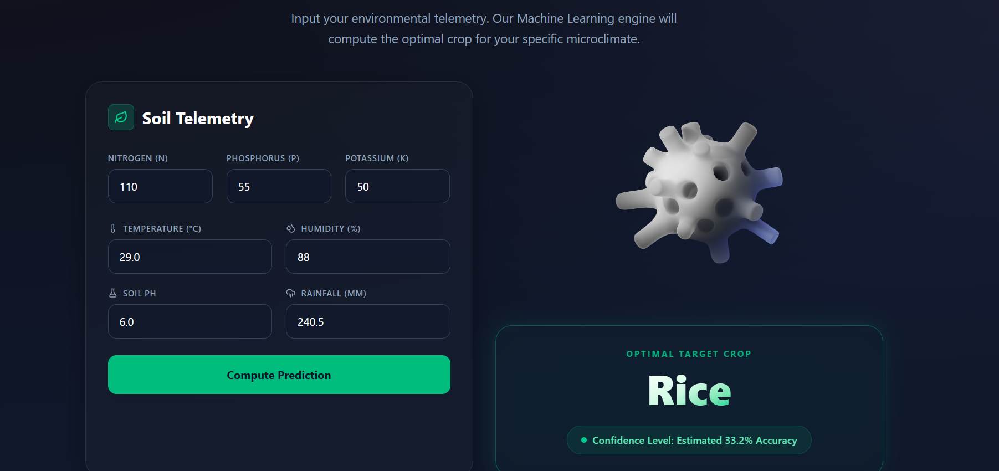

<div align="center">
  

  <h1>CropMeta</h1>
  <p>
    <strong>Decoupled full-stack ML platform for optimal crop-yield prediction via microclimate &amp; soil telemetry probability mapping.</strong>
  </p>

  <p>
    
    
    
    
  </p>
</div>

---

# 🌱 CropMeta: AI-Powered Smart Agriculture Architecture


> A highly optimized, decoupled full-stack machine learning system designed to compute optimal crop yields through microclimate soil telemetry and true probability mapping.

## Table of Contents
- [System Overview](#system-overview)
- [System Interface](#system-interface)
- [Technical Architecture](#technical-architecture)
- [Machine Learning Engineering](#machine-learning-engineering)
- [Local Deployment](#local-deployment)
- [License](#license)

---

## System Overview
CropMeta bridges the gap between raw agricultural data and actionable decision-making. By analyzing complex environmental inputs—such as nitrogen levels, phosphorus, potassium, temperature, humidity, pH, and rainfall—the system provides highly accurate crop recommendations. The architecture is completely decoupled, utilizing a high-speed REST API to communicate between the Python predictive engine and the interactive web interface.

---

## System Interface
*High-resolution visual telemetry and dynamic prediction mapping.*






---

## Technical Architecture

### Frontend Layer
*   **Framework:** Next.js, React
*   **Styling:** Tailwind CSS
*   **Functionality:** Responsive telemetry input forms, dynamic state management, and real-time REST API fetching.

### Backend & API Layer
*   **Framework:** Python, FastAPI
*   **Server:** Uvicorn (ASGI)
*   **Database:** SQLite (Lightweight local storage for telemetry logging)
*   **Functionality:** Cross-Origin Resource Sharing (CORS) configured routing, high-speed asynchronous endpoint execution.

---

## Machine Learning Engineering
The predictive core is built on **Scikit-Learn** using a Random Forest Classifier, optimized specifically for agricultural datasets.

*   **Algorithmic Pruning:** To actively prevent model overfitting on localized telemetry data, the Random Forest algorithm is strictly bounded with hyperparameter tuning (`max_depth=10`).
*   **True Probability Mapping:** Instead of outputting a singular, static classification string, the backend extracts the raw `predict_proba` matrix. This mathematical array is parsed and sent to the frontend to provide the user with mathematically backed confidence scores (e.g., 85% optimal for Wheat, 12% for Barley).
*   **Data Processing:** Pandas and NumPy are utilized for vectorization and scaling of incoming JSON payloads before inference.

---

## Local Deployment

### Prerequisites
Ensure you have the following installed on your local machine:
*   Node.js (v18+)
*   Python (3.8+)
*   Git

### 1. Clone the Repository
```bash
git clone https://github.com/Velocity07/CropMeta.git
cd CropMeta
